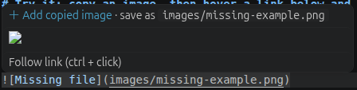
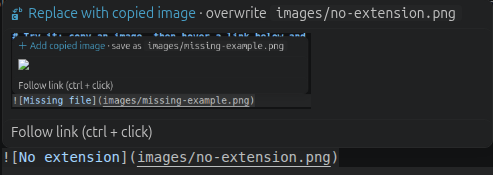

### ‼️Fully AI generated‼️
# Add The Image: save a copied image into an existing Markdown image link (VS Code extension)

**Add The Image** is a Visual Studio Code extension that fills in Markdown image links you have already written. Hover over `` and click **+ Add copied image**. The extension saves the image from your clipboard to that exact path, under that exact file name, and creates the folders if needed. If the path is empty, ``, it names the file after the description and writes the path into the link for you.

It works with screenshots, copied bitmaps, and image files copied in your file manager (Files/Nautilus, Dolphin, Finder, Explorer).

After saving, the hover reopens with a preview of the saved image and a **Replace with copied image** button:

## Why this extension?

VS Code's built-in Markdown paste and extensions such as _Markdown Paste Image_ or _Paste Image_ **insert a new link** at the cursor, using a file name they choose. That's the wrong order if you:

- write the document first and leave placeholders like `` or ``,
- have a link that points to a **missing image file** (broken image, file not found),
- want the image saved **under the name and path already in the link**, not renamed afterwards.

Add The Image works on **the link that's already there**. You don't need to save the file by hand, rename it, or retype the path.

## Features

- **Hover button.** A **+** button appears when the mouse is over a Markdown image path.
- **Empty paths.** For ``, it suggests `images/my-cat-photo.png`, lets you edit the name, then saves the image and updates the link.
- **Missing files.** For `` where the file doesn't exist, it saves the image to exactly that path and creates the folders.
- **Missing or mismatched extensions.** `` becomes `images/x.png`. If the link says `.jpg` but the clipboard holds a PNG, it asks whether to rename.
- **Replace existing images.** When the file exists, the hover shows a preview and a **Replace with copied image** button. It asks before overwriting.
- **Feedback.** A status-bar spinner runs while it works, then you get a "saved" notification with **Open Image**, and the hover reopens with a preview.
- **Copied files or raw image data.** It accepts a screenshot or any copied `.png .jpg .gif .webp .svg .bmp .tiff .avif` file.
- **Path handling.** Paths are relative to the `.md` file, and `/…` is relative to the workspace root. It understands `<paths with spaces.png>`, `%20`, and `"titles"`.
- **Keyboard shortcut.** Put the cursor on the link and press **Ctrl+Alt+I** (**Cmd+Alt+I** on macOS).
- Works on Linux (Wayland and X11), macOS and Windows.

## Usage

1. Write the link: `` or ``.
2. Copy an image (a screenshot, or a file in your file manager).
3. Hover over the link and click **+ Add copied image**.

## Install

- From a `.vsix` file: `code --install-extension add-the-image-0.1.0.vsix`
- From source: clone the repository, open it in VS Code and press **F5**.

### Requirements

VS Code's clipboard API can only read text, so on Linux a small helper is needed to read images:

| OS                                          | Needs                                           |
| ------------------------------------------- | ----------------------------------------------- |
| Linux, Wayland (Ubuntu, Fedora, GNOME, KDE) | `wl-clipboard`: `sudo apt install wl-clipboard` |
| Linux, X11                                  | `xclip`: `sudo apt install xclip`               |
| macOS                                       | nothing (uses `osascript`)                      |
| Windows                                     | nothing (uses PowerShell)                       |

## Settings

| Setting                             | Default  | Description                                                        |
| ----------------------------------- | -------- | ------------------------------------------------------------------ |
| `addTheImage.defaultFolder`         | `images` | Folder (relative to the `.md` file) for links with an empty path   |
| `addTheImage.askForNameWhenEmpty`   | `true`   | Let you confirm or edit the generated file name                    |
| `addTheImage.showForExistingImages` | `true`   | Show the preview and **Replace** button on links whose file exists |

## FAQ

**How do I paste an image into an existing Markdown image link in VS Code?**
Install Add The Image, copy the image, hover over `` and click **+ Add copied image**.

**How do I save a clipboard image to a specific path or file name from a Markdown file?**
Write that path in the link, for example ``, and click the hover button. The image is saved there.

**How do I fix broken or missing images in Markdown?**
Hover over the broken link, copy the right image, and click **+**. The missing file is created at the linked path.

**Can it fill an empty image path like ``?**
Yes. It builds a file name from the alt text, lets you edit it, and writes the path into the link.

**Why does nothing happen on Linux?**
Install `wl-clipboard` (Wayland) or `xclip` (X11). The extension shows an error message if neither is found.

## Keywords

VS Code extension, Visual Studio Code, Markdown, paste image, clipboard image, save clipboard image to file, insert image into Markdown link, fill empty image path, missing image, broken image link, image placeholder, hover button, screenshot to Markdown, documentation images, README images, Obsidian-style image paste, docs-as-code, MkDocs, Docusaurus, Hugo, Jekyll, GitHub README.

## License

MIT
